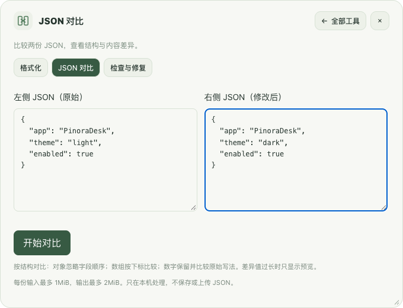
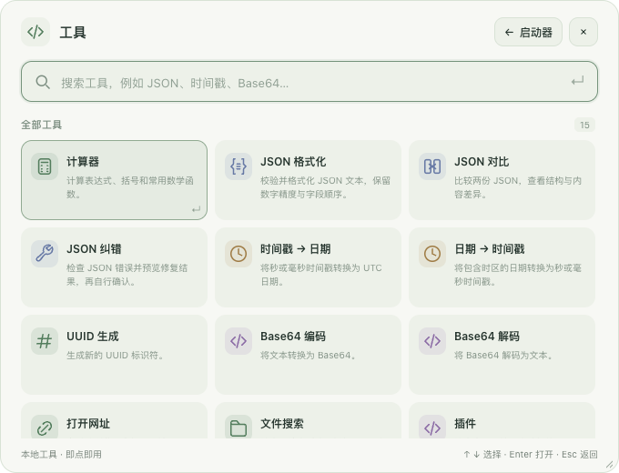

# 轻栈 · PinoraDesk

一个快捷键，打开应用、处理 JSON、截图贴图、查找文件。

轻栈是本地优先的桌面效率工具，当前提供 **Apple Silicon Mac 开发预览版**。自动剪贴板采集、截图历史、贴图保存和 WASM 运行默认关闭，由你选择开启。

**[下载应用](#download) · [功能介绍](#features) · [快速上手](#start) · [常见问题与解决办法](docs/FAQ.zh-CN.md) · [完整使用手册](docs/USER_GUIDE.zh-CN.md)**

## 下载应用

| 你的设备 | 下载入口 | 说明 |
|---|---|---|
| Apple Silicon Mac / M系列芯片 | **[下载 DMG](https://github.com/SleepyBytepp/pinoradesk-downloads/releases/download/v0.2.0-preview.1/PinoraDesk-0.2.0-preview.1-macos-arm64.dmg)** | 推荐；打开后将轻栈拖入 Applications |
| Apple Silicon Mac / M系列芯片 | [下载 ZIP](https://github.com/SleepyBytepp/pinoradesk-downloads/releases/download/v0.2.0-preview.1/PinoraDesk-0.2.0-preview.1-macos-arm64.zip) | 完整解压，将 PinoraDesk.app 放入“应用程序” |
| Intel Mac | 暂未提供 | 请勿下载 ARM64 包代替 Intel 版本 |
| Windows | 暂未提供 | Windows适配与验证尚未完成 |

[查看版本与全部附件](https://github.com/SleepyBytepp/pinoradesk-downloads/releases/tag/v0.2.0-preview.1) · [安装步骤](docs/INSTALL.zh-CN.md) · [SHA-256校验文件](https://github.com/SleepyBytepp/pinoradesk-downloads/releases/download/v0.2.0-preview.1/SHA256SUMS.txt)

**当前版本：`v0.2.0-preview.1`，应用内版本 `0.2.0`。** 最低配置目标为macOS14，已实际验证环境为macOS15.2 ARM64；其他系统版本仍需实测。这是本机开发签名、尚未公证的预览包，不是已完成正式发行验收的稳定版。[首次打开被系统拦截时的正常处理步骤](docs/FAQ.zh-CN.md#first-open)。

**公开下载，源码私有：** 应用与使用说明由独立的[公开下载站](https://github.com/SleepyBytepp/pinoradesk-downloads)提供，无需获得私有源码仓库权限。请下载明确命名的DMG/应用ZIP；GitHub自动生成的“Source code”不是应用。[下载问题](docs/FAQ.zh-CN.md#download)。

## 可以用轻栈做什么

### 搜索并打开应用

按快捷键输入应用名、中文、拼音或首字母，使用上下键选择，Enter打开。应用缓存可刷新，使用记录参与排序；支持托盘、单实例、开机启动开关和Dock恢复。

### JSON 格式化、对比与纠错

- **格式化：** 校验、格式化并定位错误，保留大整数、高精度数字和字段顺序。
- **对比：** 左右粘贴两份JSON，查看新增、删除、内容与类型变化。
- **纠错：** 常见语法错误先给修复预览，由你确认后应用，可撤销；不会猜测缺失的业务数据。

这三项可以从主搜索直接打开，不需要逐层筛选。

*界面示意使用合成示例数据，展示输入操作，不代表真实用户内容。*

### 一次进入截图，原位标注与识别文字

点击“截图”或按`Control+Option+A`，直接拖动框选区域。选区可移动、调整边角、重选，支持图形、箭头、画笔、文字、遮挡、马赛克及撤销/重做。

Enter/双击复制退出，Esc取消；可保存PNG/JPEG或直接贴图。截图与图片贴图均支持本机OCR，结果可编辑、复制及重试。识别对象是裁剪、遮挡后的最终合成图。

### 把图或文字贴在桌面

使用F3从剪贴板贴图或恢复最后关闭项，Shift+F3显示/隐藏全部。支持旋转、翻转、缩放、透明度、缩略图、分组及管理。

明确开启“记住贴图”后，才保存原图/原文、标注和位置并尝试重启恢复。可编辑遮挡仍保留原始内容，不能当作不可逆脱敏。

### 管理剪贴板和常用片段

文本历史提供全文搜索、收藏、键盘复制，常用片段可独立编辑。JSON导入先预览再确认，只新增、不覆盖，重复与冲突会提示。自动采集默认关闭，是否落盘及保留策略单独设置。

### 查找文件并直接打开

输入`file 文件名`进入Mac文件搜索，支持Spotlight和明确选中目录后的后备扫描。可受控打开或在Finder定位；“记住目录”会在重启重新校验，不代替系统权限，也不默认扫描全盘或读取正文。

### 按需扩展插件

支持本地JSON/多资源ZIP插件、启停、卸载、逐次/记住授权与撤销。WASM文本工具在独立受限进程中运行，产品开关默认关闭；没有WASI、文件、网络或shell接口。

插件来源需手动配置并独立核对公钥指纹，主动检查签名索引后才下载、预览、确认安装；无默认来源或后台检查。新装、升级或回退仍默认停用。

### 15个工具入口

| 类型 | 工具 |
|---|---|
| JSON | 格式化、结构对比、纠错预览 |
| 时间 | 时间戳→日期、日期→时间戳 |
| 文本与计算 | 计算器、UUID、Base64编码、Base64解码 |
| 系统与文件 | 打开网址、常用目录、文件搜索 |
| 截图与扩展 | 截图、贴图与截图设置、插件 |

*工具箱示意来自真实页面与合成数据。应用搜索、剪贴板及全局设置是独立功能，不计入15个工具入口。*

## 5分钟上手

1. 从上方下载与你芯片对应的Mac应用，按[安装说明](docs/INSTALL.zh-CN.md)放入“应用程序”，打开一次。
2. 从菜单栏“轻栈”打开主窗口；新配置默认快捷键是`Option+Space`，可在设置修改。开发设备演示用`Control+Option+Space`，不会自动成为你的默认值。
3. 输入应用名或工具名；上下选择、Enter执行、Esc隐藏。搜索`JSON`、`截图`、`插件源`，或输入`file 文件名`即可直达。
4. 首次使用截图，按系统提示给当前这一份应用正常屏幕录制权限，再按系统要求真正退出重开。
5. 需要剪贴板采集、截图历史、贴图记住或WASM时，在对应面板主动开启；不需要的功能保持关闭。

窗口可拖动和调整大小，文字、图标与按钮随宽度缩放。关闭窗口通常只隐藏；真正退出请用菜单栏“退出轻栈”。退出后全局快捷键也会停止。

## 常见问题，先看这里

| 遇到的问题 | 解决入口 |
|---|---|
| 下载404、只有源码、找不到app | [下载入口与访问问题](docs/FAQ.zh-CN.md#download) |
| 首次打开被macOS拦截 | [正常单应用放行与损坏提示区别](docs/FAQ.zh-CN.md#first-open) |
| 快捷键没有反应、退出后不能唤出 | [快捷键排查](docs/FAQ.zh-CN.md#launcher-shortcut) · [真正退出后的行为](docs/FAQ.zh-CN.md#quit) |
| 窗口刚打开就隐藏 | [失焦隐藏设置](docs/FAQ.zh-CN.md#hide-on-blur) |
| 已允许录屏，截图仍提示权限 | [确认同一应用副本、正常允许与重启](docs/FAQ.zh-CN.md#screen-permission) |
| F3打开调度中心、贴图没有恢复 | [功能键设置](docs/FAQ.zh-CN.md#function-keys) · [贴图记住](docs/FAQ.zh-CN.md#remember-pins) |
| 剪贴板没有记录、目录需重选 | [采集开关](docs/FAQ.zh-CN.md#clipboard) · [目录身份与权限](docs/FAQ.zh-CN.md#remember-folder) |
| 插件安装后不能运行 | [启用、WASM与授权](docs/FAQ.zh-CN.md#plugins) |
| GitHub Actions显示失败 | [当前CI限制与验证边界](docs/FAQ.zh-CN.md#ci) |

[查看完整FAQ与问题反馈清单](docs/FAQ.zh-CN.md) · [反馈问题](https://github.com/SleepyBytepp/pinoradesk-downloads/issues/new)

## 隐私与当前限制

自动剪贴板采集、截图历史、记住贴图、WASM均默认关闭。截图历史与快捷保存目录仅当前运行有效；备份可能包含你明确选择保存的个人内容。各窗口IPC独立限权，来源信任与撤销记录不会因恢复旧备份而默默回退。

当前仍缺跨屏拼接、完整混合DPI、界面元素自动识别、捕获鼠标指针、打印、选区历史快捷回看及贴图取色等。新增功能的真实保存/OCR粘贴、贴图重启恢复/多Space、完整权限/资源矩阵未全部验收。未声称完整复刻Snipaste或兼容uTools商店。

**CI现状：** 两平台前端检查通过；当前远程检查（源码仓库私有）尚未全部通过：Mac有3项本地HTTPS测试服务就绪超时，Windows存在条件编译相关Rust lint问题。本机Mac可运行不代表Windows已可用。[完整验证边界](docs/VERIFICATION_0.2.0.md)。

## 更多资料与反馈

[使用手册](docs/USER_GUIDE.zh-CN.md) · [PDF下载](docs/downloads/PinoraDesk_User_Guide_0.2.0.pdf) · [离线HTML](docs/downloads/PinoraDesk_User_Guide_0.2.0.html) · [安装说明](docs/INSTALL.zh-CN.md) · [常见问题](docs/FAQ.zh-CN.md) · [验证边界](docs/VERIFICATION_0.2.0.md)

[反馈问题](https://github.com/SleepyBytepp/pinoradesk-downloads/issues/new)。请提供版本、芯片和系统、复现步骤及错误原文，不要提交密码、令牌、原始剪贴板或敏感截图。

这是应用和说明的公开下载站，应用实现源码保持私有。仓库自动生成的“Source code”只包含下载站资料，不是应用，也不是私有实现源码。

本预览版随包提供[项目许可](LICENSE)和[第三方许可资料](THIRD_PARTY_NOTICES.txt)。本机开发签名与当前CI限制见版本说明；本下载站不代表Apple公证或稳定版承诺。
