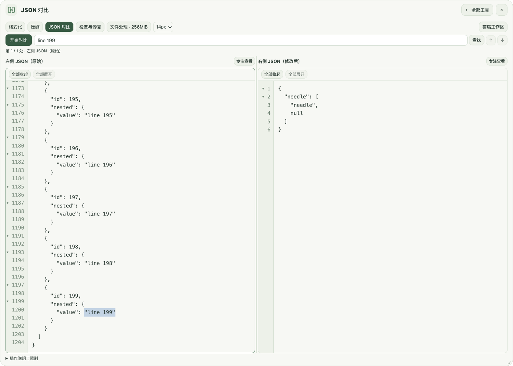

# 轻栈 PinoraDesk 使用手册

> 适用版本：v0.2.0-preview.2，Apple Silicon Mac预发布。请保存当前内容并退出旧版后安装。品牌栏空白基本拖动已由用户确认；完整窗口与实体多屏矩阵仍需按验证范围分别实测；Windows暂停。


版本 0.2.0 · 说明更新 2026-11-11 · Mac 预发布

本手册介绍当前功能、下载安装、隐私设置和常见问题，面向应用使用者。源码保持私有，公开下载站不包含实现源码。测试通过不等于全部真实设备验收。工程中的功能仍在完善，不能视为已完成正式发行或与其他产品完全一致。

## 1. 产品与当前状态

PinoraDesk（中文名“轻栈”）是本地优先的桌面启动器与效率工具。通过快捷键唤出搜索框，查找应用、工具和插件命令，完成 JSON 处理、截图、贴图、文件搜索等操作。

- 产品名：PinoraDesk（轻栈）。
- 项目名称：pinoradesk。
- 应用标识：`io.github.sleepybytepp.pinoradesk`。
- 技术：Tauri 2、Rust、Vue 3、TypeScript、SQLite。
- 已验证的开发设备：macOS 15.2 ARM64。
- 平台目标：macOS 14+ ARM64、Windows 11 x64。
- Windows 工作按用户要求暂停；Windows 功能适配、最低 macOS 版本实机和完整安装升级仍未全部完成或验证。
- 代码采用 MIT；依赖、字体、模板图标及其他资源分别适用各自许可。

应用不会默认开启剪贴板采集、截图历史、贴图保存恢复或 WASM 运行。没有默认插件来源，也没有后台插件来源检查。用户明确打开网页、启动应用、检查插件来源等动作会按相应功能访问系统或网络；“本地优先”不等于所有功能永不联网。

## 2. 第一次使用

### 2.1 下载并安装Mac预览版

应用由独立的公开下载站提供，源码仓库仍私有。访问 https://github.com/SleepyBytepp/pinoradesk-downloads ，打开 v0.2.0-preview.2 版本页，选择 macOS ARM64 的 DMG 或应用 ZIP。Apple Silicon／M系列Mac适用；Intel和Windows当前没有应用包。

DMG打开后将PinoraDesk.app拖入Applications；ZIP完整解压后将App放入“应用程序”。配置目标macOS14+，当前实际验证macOS15.2 ARM64。已有旧版运行时先从菜单栏真正退出，再替换同一位置的副本。源码ZIP不是应用；公开下载站自动生成的Source code只包含下载站资料，也不是私有应用源码。

当前是本机开发签名、未公证的开发预览版。首次打开仅按系统正常的单应用例外流程处理，具体步骤见安装说明与FAQ；不要关闭整机安全检查，不要把“已损坏／恶意软件”提示当普通开发者验证提示跳过。下载附件提供SHA-256校验文件。

### 2.2 唤出、搜索与退出

源码的启动器默认快捷键是 `Option+Space`。如需与 uTools 等软件共存，可在设置中改为 `Control+Option+Space`；这不是新安装的默认值。

1. 启动应用，在菜单栏找到“轻栈”。
2. 用启动器快捷键打开搜索框，直接输入应用名或工具名。
3. 用上下方向键选择结果，Enter 执行，Esc 隐藏或返回。
4. 在设置中修改快捷键；与其他软件冲突时选择独立组合。
5. 点击 Dock 图标可恢复主窗口；窗口关闭按钮通常只隐藏窗口。
6. 真正结束应用，请使用菜单栏中的“退出轻栈”。应用退出后，全局快捷键也会停止。

主窗口可拖动、调整大小，文字、图标和按钮会随逻辑宽度缩放；窗口本次运行中隐藏再唤起会保留大小，重启采用默认尺寸。

### 2.3 常用入口

| 入口 | 操作 |
|---|---|
| 主搜索 | 搜索应用、工具、已启用且可用的插件命令 |
| 工具箱 | 查看卡片、搜索工具和最近使用；可直接点开 JSON 格式化、压缩、对比、纠错 |
| 剪贴板 | 进入文本历史、收藏与常用片段；自动采集需自己开启 |
| 设置 | 快捷键、失焦隐藏、开机启动、主题、语言、结果数量、数据维护 |
| 文件搜索 | 搜索 `file 文件名`，或直接打开“文件搜索” |
| 截图 | 搜索“截图”、菜单栏“截图”，或使用截图快捷键 |
| 连续跨屏 | 搜索“截图”／“跨屏截图”，或按截图快捷键 |
| 跨屏总览 | 搜索“跨屏总览”，或点“贴图与截图设置 → 跨屏总览截图” |
| 贴图管理 | 工具箱中的“贴图与截图设置” |
| 插件管理 | 搜索“插件”“WASM”“插件源”，进入插件页面 |

### 2.4 常用快捷键

| 场景 | 默认或操作 |
|---|---|
| 唤出启动器 | Option+Space；可在设置修改 |
| 区域截图 | Control+Option+A；可在设置修改 |
| 剪贴板贴图或恢复最后关闭项 | F3；Mac 可能需要 Fn+F3 |
| 显示/隐藏全部贴图 | Shift+F3 |
| 搜索结果 | 上下选择、Enter 执行、Esc 隐藏 |
| 文件结果 | Enter 打开、Command+Enter 定位、右方向展开操作 |
| 截图选区 | 拖动框选，边角调整，Enter/双击复制退出，Esc 取消 |
| 选区内截图历史 | 逗号 `,` 较早，句号 `.` 较新／回到当前截图；需主动开启本次记录 |
| Mac 图像打印 | Command+P；截图选区、主窗口图片编辑器或贴图 |
| 选区／主窗口图片编辑器贴图 | Command+T |

F3、截图和启动器快捷键可以按自己的习惯设置；系统功能键行为及其他应用占用可能影响触发。

## 3. 当前 18 项工具

工具箱当前包含18项工具，按 JSON、截图与贴图、文本与编码、时间、计算、文件与系统、扩展分组；同类工具集中显示，输入关键词仍可直接搜索。应用启动、剪贴板和全局设置属于独立主功能，不计入这18项。

| 工具 | 主要用途 |
|---|---|
| 计算器 | 表达式、括号和常用数学函数 |
| JSON 格式化 | 校验并格式化 JSON，保留高精度数字和字段顺序 |
| JSON 压缩 | 移除结构空白，保留大数字、字段顺序和字符串内容；不自动纠错 |
| JSON 对比 | 比较两份 JSON 的结构、字段与内容差异 |
| JSON 纠错 | 定位语法问题，预览常见修复，确认应用及撤销 |
| 时间戳 → 日期 | 秒或毫秒时间戳转 UTC 日期 |
| 日期 → 时间戳 | 带时区日期转秒或毫秒 |
| UUID 生成 | 生成 UUID v4 |
| Base64 编码 | 文本编码为 Base64 |
| Base64 解码 | Base64 解码为文本 |
| 打开网址 | 用默认浏览器打开网址 |
| 文件搜索 | 系统索引、明确选择目录后的扫描、打开或 Finder 定位 |
| 插件 | 本地声明式包、WASM 文本工具及签名来源管理 |
| 常用目录 | 打开个人目录、桌面、文稿和下载 |
| 截图 | 自由拖选、窗口矩形、标注、取色、OCR 与导出 |
| 跨屏截图 | 在 2–4 个实体屏幕间连续拖选一个区域 |
| 跨屏总览 | 将全部屏幕缩放至一个窗口后拖选 |
| 贴图与截图设置 | 图片导入、历史、保存目录、贴图分组及保存恢复 |

### 3.1 JSON 工具示例

格式化输入例如：

```json
{"name":"PinoraDesk","enabled":true,"count":3}
```

打开“JSON 格式化”，粘贴内容后执行格式化；无效输入会显示错误位置。数值处理保留大整数与高精度数字，避免简单转换为浮点数导致精度丢失。

搜索“JSON 压缩”或 `json minify` 可直接进入压缩；也可在 JSON 面板的四个标签间切换。压缩保留原文，点击“复制结果”才写入剪贴板；无效或超限数据会显示错误，不猜测修复。

“JSON 对比”有左右两份输入，用于发现新增、删除和内容变化。它比较 JSON 数据，不是代码版本控制工具。

发现差异后，可用“上一处差异／下一处差异”或 `F7`／`Shift+F7` 逐项查看；点击“定位左侧原文／定位右侧原文”会选中对应值并滚动到位置。新增项仅提供右侧定位，删除项仅提供左侧定位。编辑输入后旧结果立即清除，需要重新对比；窄窗口可切换查看左侧或右侧，内容不会因切换丢失。

“JSON 纠错”先显示问题与可修复预览，再由你确认应用；可撤销。修复只覆盖已经支持的常见语法问题，不保证能理解任意残缺内容或猜出业务意图。处理重要数据时保留原文再确认。

在 **JSON 工作区**中，进入工具会打开大工作区；点击 **铺满工作区／还原工作区**可调整到当前屏幕可用区域或恢复原尺寸。系统标题栏和品牌栏空白支持拖动；品牌栏文字也可作为拖动区域，按钮和输入框保持原有操作。品牌栏空白的基本拖动已由用户实测确认；后台首按、20 轮连续拖动及多屏／全屏矩阵仍未全部验收。拖动窗口边缘可改变大小。窗口变大时增加可见内容，字体独立选择12／14／16／18px；原文与结果可并排查看、拖动分隔条调整宽度，或点击“专注查看”独占内容区。窄窗口使用面板切换，避免两个小框挤在一起。

顶部查询框、查找与上一／下一处固定可见，只滚动下方 JSON 内容。按 **⌘F**、输入内容、按 Enter 即可**全局查询**，不用区分 Key 或 Value。文本模式同时查原文和有效结果，对比模式同时查左右两份内容，匹配导航会显示所在文档。字符串按解码后的内容、数字按原始写法匹配，同时支持 `true`、`false`、`null`；区分大小写。无效 JSON 自动退回原文查找并提示，不把语法错误伪装成没有匹配。

各编辑区左侧显示真实行号；多行对象和数组旁的箭头可以逐层**收起／展开**，也可全部收起／展开。查找会展开遮住匹配位置的结构。折叠只改变显示，复制使用完整原文；需要修改已折叠内容时，点击正文或按 Enter 先展开后编辑。单行压缩 JSON 可先格式化再折叠。

文件模式使用顶部的**文件全局查找**，默认查当前结果或草稿，对比会依次查左、右文件。点“从头查找／查找下一处”定位，可取消后台查询；高级选项保留指定文件、原文和JSON Pointer查询。仍只加载当前片段，超长值可继续分段查看。文件片段显示全文件行号，只能折叠片段内完整且可确认的对象或数组；跨片段结构不伪造闭合。点“专注预览”收起处理详情，将空间让给内容；查询栏仍固定。按 Esc 可退出专注，当前片段保留。



*示例数据由测试生成，不包含用户内容。顶部查询固定，字号与窗口大小独立调整。*

### 3.1.1 大文件 JSON（Mac 预发布版）

打开任一 JSON 工具，点击 **文件处理 · 256MiB**，选择文件后执行格式化、压缩、对比或修复。普通粘贴文本模式仍保留每份 1MiB 的保护；几十 MB、上百 MB 的内容请直接选文件，避免整份内容塞入编辑框。

- **自动识别（默认）**：读取实际文件大小，显示匹配的 5／10／100／256 MiB 档位。
- **手动上限**：可切换 5、10、100、256 MiB。档位表示每份文件允许的最大大小，不代表截取长度或不同精度；超限会提示切换，不截断数据。对比时左右文件分别限制，自动档位取较大一份。
- **处理与取消**：后台运行并显示进度，可随时取消；返回文本模式或离开工具也会结束文件会话。状态读取异常时可重新检查或取消。
- **结果预览**：每段最多 64KiB，用上一段／下一段浏览；对比逐项显示差异，支持 F7／Shift+F7，并跳到对应文件的原文片段。最多保留 200 处差异预览，同时显示总数。
- **保存**：格式化、压缩或修复后点击“另存结果”，选择一个新的文件名。不会自动写剪贴板、上传或覆盖原文件；已有同名目标会拒绝保存。文件模式提供按段预览与编辑，不把上百 MB 全文装入页面。
- **修复范围**：BOM、JSON 代码围栏、注释、单引号、普通未加引号的键、尾随逗号及 True／False／None；先列出修复项，再另存。重复键、缺失值和不完整字符串不会猜测修复。

大小单位为 MiB（1 MiB = 1,048,576 字节）。单份最多 256MiB；支持 UTF-8 单个 JSON 根值，以及 JSONL／NDJSON（每行一条 JSON）。文件格式可选择“按扩展名识别”或手动指定 JSON／JSONL；.jsonl 和 .ndjson 自动使用逐行模式，其他扩展名默认 JSON。大整数、数字原文、字段顺序和字符串内容保留；对比忽略对象字段排列，数组按位置比较，`1` 与 `1.0` 按不同数字原文处理。

为控制资源，文件模式最多 128 层、2000 万节点；同时存活的对象键最多 20 万个／32MiB，单键与对比路径最多 64KiB，结果最多 1GiB，临时对比索引最多 4GiB，单次任务最多 3 分钟。极宽对象、极深数据或磁盘空间不足可能在文件大小上限内提前停止并提示。处理期间请不要在其他程序修改源文件。

结果与索引临时保存在本机应用缓存中，离开文件模式后清理；意外退出留下的本功能任务目录在下次打开文件模式时清理。另存优先选择本机磁盘；不支持原子创建的文件系统会提示换位置，不退回覆盖保存。

Apple M1／16GiB 内存本机生成样本测试：约 30／128／256MiB 的格式化分别约 0.36／1.65／3.08 秒；两份同等大小文件对比分别约 2.62／10.39／22.38 秒。测试数据是包含中文、长整数及数组的重复记录，不代表所有结构的速度；后台流式处理和有界预览避免将整个文件放入页面，仍需结合实际文件与设备确认体验。Windows 继续暂停；上述为合成样本测量，不保证任意设备和数据均达到相同速度。

### 3.1.2 JSONL、完整差异与分段编辑（Mac 预发布版）

- **JSONL／NDJSON**：每个非空物理行是一条完整 JSON 值，空行忽略并计数；支持 CRLF。单条记录最多 16MiB，整个输入仍最多 256MiB。格式化保持每条一行；多行展开的单个对象请选 JSON。错误显示实际行号和字节位置。对比按有效记录的顺序，不按某个业务字段自动配对。
- **完整差异导出**：对比完成后点“导出完整差异”，另存为 JSONL。页面仍最多展示 200 处，报告包含全部差异的路径、类别、左右字节位置和有界值摘要。超过 512 字节的值摘要会标记截断；报告不是双方原值全文。选中新文件名，不覆盖已有文件。
- **分段修改**：在格式化、压缩或修复结果中，浏览到目标段，点“编辑此片段”；一次替换最多 64KiB 原文，输入最多 256KiB。点“应用修改并校验整份文件”，后台校验全部内容，通过后才生成新结果；不会改写源文件。对比报告只读。
- **失败与撤销**：校验失败可继续修改原草稿，或点“返回上一有效版本”；成功后也能恢复最近一个有效版本。未提交草稿时禁止直接翻页、切换文件或离开工具，需先应用或放弃。退出应用不会长期保存未另存结果。

本机 128MiB JSONL 合成样本（16,309 条，含长整数）：格式化 1.62 秒；两份文件完整索引、对比并输出 16,309 条差异 4.18 秒；修改一段并校验整份文件 1.32 秒。核心测试进程峰值内存约 12.6MiB，**不是整个应用内存**，实际速度取决于数据结构、磁盘和设备。原文件整份 SHA-256 前后相同。文件选择、另存面板与用户自己的数据仍需实际使用验收。

### 3.2 时间、编码与系统工具

时间戳转换注意选择秒或毫秒；日期输入应包含明确时区，输出按面板说明使用 UTC。Base64 是编码方式，不是加密。UUID、计算器与文本编码在本机计算；打开网址、常用目录等会调用系统对应应用。

## 4. 应用搜索与窗口设置

应用搜索支持中文名称、拼音、首字母、子串和模糊匹配，并结合使用记录排序。可刷新应用缓存；失效入口会给出反馈。

主窗口提供快捷键唤出、输入焦点、键盘导航、失焦隐藏和 Dock 恢复。开机启动默认关闭，在设置中主动开启；设置由本机 SQLite 保存。

如果主窗口刚出现就消失，先检查“失去焦点时隐藏”。若窗口完全没有唤出，使用菜单栏入口，并检查快捷键是否与其他软件冲突。设置窗口可以单独打开。

## 5. 剪贴板与常用片段

### 5.1 文本历史

剪贴板自动采集默认关闭。开启后按页面选项控制内存或落盘、限额、保留期限、排除与清空等行为。支持全文搜索、收藏筛选和键盘复制。未自动采集图片、文件或用户的历史内容来完成验证。

剪贴板可能包含口令、验证码和个人信息。是否开启及是否保存由使用者决定；当前来源识别与排除能力存在平台限制，不能把它当成覆盖所有敏感软件的强隔离机制。

### 5.2 常用片段与 JSON 导入

片段可以独立编辑和收藏。导入流程为：选择 JSON 文件或粘贴 JSON → 查看预览、重复及冲突 → 明确确认 → 新增片段。

- 不覆盖已有片段与收藏状态。
- 同标题同文本视为重复；同标题不同文本显示冲突并跳过。
- 无效行阻止整批导入，避免部分错误内容被默默写入。
- 确认时检查预览是否仍对应当前数据；过期后需要重新预览。
- 实际新增在一个数据库事务内完成；失败不保留半批结果。

优先导入本应用导出的 JSON，不把任意格式的文本直接当成受支持的导入文件。

## 6. 截图与文字识别

### 6.1 一次进入自由选区

点击“截图”或按 Control+Option+A 后，直接进入桌面选区；不需要再点一次“区域截图”，正常流程也不进入系统共享选择器。

1. 按住鼠标左键拖出任意矩形，或使用已有的窗口矩形选择。
2. 拖动选区内部移动位置，拖动八个边角点调整边界，需要时选择“重选”。
3. 原位使用矩形、椭圆、箭头、画笔、文字、遮挡、马赛克等工具。
4. 根据需要撤销/重做、识别文字、复制、保存、贴图或打印。
5. Enter/双击完成复制并退出；Esc 取消。

工具栏提供中文说明。Mac 上首次点击可以直接拖动、开始时不再闪动，已有本机用户验证。其他导出、权限和多屏场景仍应按验证边界看待。

### 6.2 PNG、JPEG 与保存目录

支持 PNG/JPEG 导出。快捷保存目录必须主动通过原生目录选择器设置，且仅在本次运行有效；应用会创建新文件名，不覆盖现有文件。

未选择快捷目录时使用普通原生保存面板；同名替换需要使用者在系统面板中明确确认。目录移动、替换或权限失效后，应重新选择目录，不会把旧授权重绑到新位置。

### 6.3 OCR

截图选区和图片贴图均可识别文字。Mac 使用本机 Vision，识别对象是已经裁剪、标注、遮挡后的最终合成像素，不是隐藏在编辑历史中的原图。

识别结果可编辑、复制、取消及重试。修改图片会使旧结果失效。自动测试中的遮挡验证只证明该固定合成图用例，不代表任何不完整遮挡都能达到脱敏效果。

### 6.4 截图权限

区域截图需要 macOS 正常的屏幕录制授权。若没有权限，在系统设置“隐私与安全性 → 屏幕与系统音频录制”中允许正在运行的那一份应用，按系统要求真正退出后重新打开。

若系统没有列出应用，可正常使用“+”添加当前应用。仅关闭窗口不等于退出，启动器退出后快捷键也不会继续工作。应用不自动重置权限、不绕过系统检查。

本机打包脚本复用固定签名身份以减少重建带来的身份变化，但固定签名不保证所有系统版本或机器都自动保留权限。

### 6.5 打印最终合成图（Mac 预发布版）

截图选区、主窗口图片编辑器可点击“打印”或按 `Command+P`；贴图可用右键菜单“打印…”或 `Command+P`。主窗口图片编辑器的置顶贴图快捷键为 `Command+T`，截图选区也支持此组合。

打印使用当前裁剪、标注、遮挡及贴图旋转／翻转后的最终图像像素，按比例排入纸张，打开正常的 macOS 打印面板，由你选择打印机、纸张等设置并确认。它不打印编辑界面，也不会自动发送打印任务。正在拖选或绘制半笔标注时，请先松开鼠标完成操作再打印。

取消打印会保留当前编辑，不结束选区或关闭贴图；系统返回未完成时会提示检查系统面板。显示“打印任务已提交”仅代表系统接受了该次操作，不代表打印机已经实际出纸。源图已被清除、窗口已关闭或失效时，应用不会重新打开旧图。真实打印机与纸张输出尚未实测，当前验证范围见[截图增强阶段记录](VERIFICATION_0.2.0.md)。

框选前和拖动选区时，会显示跟随鼠标的横竖虚线，方便对齐；跨屏时沿用同一图像坐标。松手进入标注后自动隐藏，辅助线不会进入复制、保存、贴图或打印的图片。

实体跨屏时，副屏也支持像素放大镜：选区后按住 `Option` 查看，按 `Shift` 切换 RGB／HEX，按 `C` 复制当前颜色。遮挡区域取得的是最终黑色，不会复制遮挡前颜色。右键依次返回选区、重新框选、取消；中键贴图，`Command+A` 选择整个合成桌面。箭头／直线之间按 `Tab` 切换，标注时用 `1`／`2`、方括号或滚轮调整粗细；`Space` 可暂时隐藏工具栏以便查看被挡住的位置。

### 6.5.1 鼠标动作与控件吸附（Mac 预发布版）

打开“贴图与截图设置 → 鼠标操作设置”，分别设置截图双击／中键／右键／标注滚轮，以及贴图双击／Shift＋双击／中键／右键／普通滚轮／Ctrl 或 Command＋滚轮。修改自动保存，下次截图或新建贴图生效；“恢复默认鼠标操作”仅恢复这组动作。按住左键自由拖框和拖动边缘调整大小保持不变，主副屏使用同一套设置。

默认动作：截图双击复制、中键贴图、右键退回上一步或取消；贴图双击关闭、Shift＋双击缩略图、中键恢复大小与透明度、右键菜单、滚轮缩放、Command＋滚轮透明度。配置为“保存截图”时跟随工具栏 PNG／JPEG 选择。正在标注贴图时，普通滚轮仍用于画笔粗细。

“自动吸附窗口内控件”默认关闭。开启后鼠标停留在支持的按钮、输入框等控件上，会显示边界；单击接受边界，按住左键则直接自由框选。该能力需要正常的 macOS 辅助功能权限；没有权限时可点“打开辅助功能设置”自行开启，再“重新检查”。应用只读取控件位置和大小，不读取控件文字或自动修改系统权限。目标不支持、窗口已经移动或识别超时，均退回窗口吸附与手动选择。历史截图不使用当前桌面的控件边界。真实第三方应用的控件支持程度仍待桌面验收。

### 6.6 跨屏总览与鼠标指针（Mac 预发布版）

搜索“跨屏总览”直接进入，或在“贴图与截图设置”点“跨屏总览截图”。应用会按桌面实际排列合并可用屏幕，在捕获开始时鼠标所在的屏幕显示总览；直接拖出跨越多个屏幕的矩形，再复制、保存、贴图或打印，不需要再点一次区域按钮。屏幕虚线和尺寸标记只是排列参考，不会写进导出的图片。

总览保留左侧／上方负坐标、不同像素密度和旋转后的屏幕排列；镜像副屏不重复拼接。不同屏幕采用统一输出比例，屏幕间空隙在 PNG 中保留透明，JPEG 使用白底。为流畅操作，合并图最多 1000 万像素；需要缩小时会等比调整并显示缩小比例，而非静默丢弃某块屏幕。无法满足安全预算或显示器发生变化时会提示重新截图，Esc 仍可退出。

**实体跨屏与总览是两个入口。** 现在直接点“截图”、搜索“跨屏截图”或按截图快捷键，在 2–4 块屏幕上显示各自覆盖层；按住鼠标可从一块屏幕拖到另一块，松手后在所在屏幕使用工具栏，Enter 复制、Esc 取消。单屏保留原流程；超过 4 块屏幕会提示使用总览。新增实现尚待真实多屏、混合 DPI 与独立 Spaces 验收。各屏分别取帧，不保证同一时刻，动态图像可能有时间差。R 只在桌面布局、输出比例和截图类型仍匹配时恢复原区域，避免沿用其他屏幕的旧坐标。

**高清输出。** 普通截图和实体跨屏保持最高屏幕像素密度对应的统一比例，不再自动缩小到 1000 万像素；例如两块横向 4K 屏幕输出可为 `7680 × 2160`。低密度屏幕会按统一比例映射，不会凭空增加细节。硬上限为 4000 万像素、单边 16384，实际还受屏幕排列和预览内存预算限制，不是所有接近上限的布局都能使用。超限时可点“跨屏总览（缩小）”继续，只有主动选择该入口才会缩小。PNG 保留透明空隙，JPEG 使用白底；每张编码图片仍限 32MiB，复杂图像超限时请缩小选区。

高清贴图会按解码后的画布容量计算总量，达到容量时请先销毁不需要的贴图（仅关闭仍可恢复，不会释放该额度）。可用的贴图不一定能“记住”：重启恢复仍限制图像和视图合计 64MiB，超限会明确提示，请先保存 PNG 或裁剪。OCR 和打印仍使用同一张最终选区图，系统识别／打印耗时与原生对话框不属于画布预算保证。

在“截图选项、记录与保存位置”中主动开启“截图包含鼠标指针”，下次屏幕截图生效，选择会保存；默认关闭，不改变当前已经冻结的图像。总览仅在捕获锚定的那块屏幕请求包含指针，以避免多屏重复；若捕获期间鼠标移到其他屏幕，可能没有指针。它不移动系统光标，也不申请辅助功能或修改录屏授权。

本 Mac 预发布版包含高清截图与跨屏功能。实际设备和系统权限的验证边界见[验证说明](VERIFICATION_0.2.0.md)。

## 7. 贴图、分组与历史

### 7.1 贴图操作

主动使用 F3 时，可从剪贴板贴图或恢复最后关闭的贴图；Shift+F3 显示/隐藏全部。支持图像、文字、颜色及受限本地图片文件来源。

- 右键打开原生菜单，Space 进入标注。
- 1/2 旋转，3/4 翻转，滚轮缩放。
- Command+滚轮调整透明度，中键复位。
- Shift+双击切换缩略图；关闭项可以恢复，销毁则移除对应项。
- 可从贴图进行 OCR、复制、导出或打印。

### 图片贴图取色与局部放大

在图片贴图上按住 Option（Alt）并移动鼠标，可查看局部像素放大、HEX 和 RGB；松开返回原交互。也可从右键菜单进入“取色与放大”，按 Esc 结束。进入取色后可单击图像、按 C 或点“复制颜色”复制当前 HEX。

取色使用当前标注、遮挡、旋转和翻转后的合成图像，图像透明处按贴图的白底合成；不包含系统窗口透明度或桌面背景。文字贴图不提供图像取色。

### 7.2 贴图管理与记住

“贴图与截图设置”中的管理区支持分组、显示/隐藏、关闭、分组改名和单张贴图分组。需要重启恢复时，明确勾选“记住贴图”；默认不保存。

记住后保存的是原图/原文、可编辑标注、旋转/翻转/缩放、位置、尺寸、透明度与分组。上限3项/64MiB，含解码预算；坏图或超限会提示，不应导致整个应用崩溃。关闭记住或清除会删除恢复记录，保留当前窗口。

**注意：可编辑遮挡不是不可逆脱敏。原图及原文仍可能保存在本机数据中。** 需要对外分享时使用最终导出图，并检查实际内容。

### 7.3 本次运行的截图历史

截图历史默认关闭。开启后，只记录成功导出的最终合成 PNG，最多8张/32MiB压缩数据；仅在内存中，本次运行退出即清空。

可重新打开历史图继续编辑、复制、保存或贴图。进入截图选区后，按逗号 `,` 查看更早一张，按句号 `.` 查看较新一张，直到回到这次新截图；也可点击界面的 `‹`／`›` 按钮（上一张／下一张）。切换前会保留各张图的裁剪框，历史图中的标注已合成为像素，不能撤销为原始内容。

有尚未完成的拖选、标注、可撤销标注、正在进行的文字识别或尚未收起的识别结果时，应用会提示先处理当前内容，不直接切走。可先复制／保存，再按 `Command+Shift+Z` 清除标注，或收起文字识别后切换。没有历史、已到边界或切换被阻止时，只显示提示，保留编辑与识别结果。

清空或关闭历史会使旧历史视图失效，待处理的导出和识别结果会重新校验，迟到任务不能写回历史或继续使用已失效的图像。已经写入文件、系统剪贴板或交给系统打印预览的内容无法由清空历史撤回；打印本身不新增截图历史。

## 8. 文件搜索

Mac 文件搜索提供系统 Spotlight 文件名查询，以及用户明确选中目录后的后备扫描；不默认全盘爬取或读取文件正文。

输入 `file report` 可带查询进入文件页。选中结果后 Enter 打开、Command+Enter 定位，或展开动作选择操作。打开对象受类型、路径、身份和链接规则限制；并非任意可执行文件或脚本都可以通过它启动。

“记住此目录”默认不勾选。开启后保存普通 NSURL bookmark 与原位置身份，启动时重新检查原路径、设备/inode、链接和系统访问权限。它只记住应用内的选择，不产生新的系统权限；失效、移动或替换时提示重新选择。

后备扫描支持取消与异步结果；大型目录、文件变化、索引恢复和完整性能矩阵仍需继续验证。

## 9. 插件、WASM 与插件来源

### 9.1 本地声明式插件

支持本地 JSON 和 ZIP 包，安装前展示身份、版本、命令、资源和权限。新安装默认停用；启用后按命令需要给予单次或记住授权，可随时撤销、停用或卸载。

声明式动作使用宿主已经实现的能力，不执行任意 shell、Node 脚本或网页 preload。路径动作必须由用户用原生选择器选择对象。ZIP 及资源有限额，拒绝危险路径、未知结构或不支持的内容。

### 9.2 WASM 文本工具

WASM 让插件开发者把文本处理逻辑打包为受限二进制模块。能力已编入默认构建，但产品运行开关默认关闭，启用需要独立确认。

当前使用 `pinora-text-v1`、schemaVersion2、Wasmtime50.0.1，在独立运行进程中处理文本。没有 WASI、文件系统、网络、剪贴板或 shell 接口；可选消息权限单独处理。

运行有时间、内存、栈、输出、队列和并发限制，支持取消；停用、撤销或卸载使旧任务不能提交结果。Mac 的 RSS 限制是监测后终止，并非系统硬内存隔离。Windows 运行在进程控制验证前保持不可用。

SDK示例未随公开下载站提供，需要维护者另行提供可信插件包。安装时先审阅包，开启 WASM，再启用插件并按需授权，不应安装来历不明的包。

### 9.3 签名 HTTPS 来源

来源页面无默认地址、无后台下载。使用顺序：

1. 从可信发布者取得来源 ID、HTTPS 索引地址、密钥 ID 和公钥。
2. 在本机计算指纹，通过独立渠道核对后明确保存信任。
3. 主动“检查来源”，下载并严格验证签名索引。
4. 选择兼容、未撤销版本，下载后预览权限，再确认安装。
5. 新装、升级或回退后仍默认停用，重新审阅授权。

下载采用 HTTPS 证书/主机名检查、公共地址限制、同源约束和大小限制，不自动跟随重定向。包及声明摘要需与签名条目相符；签名不能证明插件业务逻辑没有缺陷或恶意。

移除来源会阻止相关命令，但不会自动删除插件。支持经验证的上一版本回退；已经撤销的版本不能因旧预览或本地安装入口绕过确认。

### 9.4 恢复备份后的来源安全

真正应用备份前重新读取当前来源安全记录。可读时保留当前信任配置，合并单调序列、接受时间和撤销记录；清除索引缓存，必须再次主动检查。

当前数据缺失、损坏或不可读时，其他数据仍可恢复，但不自动信任备份中的旧来源。保留安装绑定/归档用于识别，需重新确认信任。恢复备份不应使已撤销版本或已移除的信任自动复活。

## 10. 设置、数据与隐私

| 项目 | 初始状态与范围 |
|---|---|
| 开机启动 | 默认关闭，设置中主动开启 |
| 失去焦点隐藏 | 默认开启，可在设置关闭 |
| 剪贴板自动采集 | 默认关闭；内存/落盘和保留策略按面板选择 |
| 截图历史 | 默认关闭；仅本次运行内存，不写磁盘 |
| 记住贴图 | 默认关闭；开启后会保存原图/原文和可编辑状态 |
| 记住文件目录 | 默认不选；重启重新检查身份与访问 |
| 快捷保存目录 | 主动选择，仅本次运行 |
| WASM 运行 | 默认关闭；插件仍需单独启用和授权 |
| 插件来源 | 无默认来源和后台检查，用户主动操作才联网 |

设置和部分数据保存在应用数据目录的 SQLite 中；各窗口使用独立 IPC 白名单。备份恢复会保留当前系统开机启动选择，并重置需要重新确认的采集设置。备份可能含片段、用户设置及明确开启保存后的贴图原始内容，应按个人数据保管。

公开下载站不包含个人配置、诊断、截图记录、签名私钥或应用实现源码。备份仍应按个人数据保管。

## 11. 验证结果与仍未完成项

### 11.0 当前 Mac 预发布验证（2026-11-11）

- 前端单元 101 项、Rust release 库 338 项通过；5 项原有忽略项未执行。
- 完整隔离页面回归 24 个场景、480 项通过；另有 Mac 品牌栏拖动组件 13 项通过。
- 类型检查、格式、严格 Clippy 和 Mac ARM64 构建通过；最终候选的本地签名、DMG、ZIP 完整性、解包后签名及二进制一致性检查通过。这不等于 Apple 公证或跨机器安装验收。合成页面检查不代替系统权限与实体多屏验证。
- JSON 约 1 MiB 首次输入／显示约 0.2 秒，观察到 169 ms 主线程长任务；更大文件使用后台文件模式。该测量并非所有设备的性能保证。
- Windows 暂停；跨机器安装、Apple 公证和完整硬件矩阵仍未完成。详情见[验证范围](VERIFICATION_0.2.0.md)。

### 11.1 2026-11-05 的验证快照

| 验证层级 | 实际结果 |
|---|---|
| 前端单元 | 60项通过 |
| Rust 库测试 | 236项通过，默认忽略5项 |
| 后备扫描进程集成 | 1项通过 |
| 合成界面 | 96项通过，使用模拟 IPC 与合成数据 |
| 原生 WKWebView | 生产页面/CSP/权限配置与合成红蓝图选区通过 |
| 原生 Vision | 另行执行1项最终合成图/遮挡 OCR 测试通过 |
| WASM 进程场景 | 17种场景通过，含超时/权限/输出等边界 |
| 签名来源 | Rust总测试中20项来源/HTTPS/事务/恢复用例通过 |
| Mac app | 本机构建、固定证书校验、实际启动通过 |
| 远程CI | 两平台前端通过；Mac有3项HTTPS夹具超时，Windows Rust lint失败 |
| Windows应用 / 最低macOS | 未验证，不能推断通过 |

上述为 2026-11-05 历史快照；其中默认忽略的5项只额外运行了原生 OCR 1项，其余4项探针/基准未在当时重跑。当前版本的验证结果与未验收项见[验证说明](VERIFICATION_0.2.0.md)。WASM进程、原生 OCR、WKWebView 合成选区、模拟 IPC 和真实用户操作是不同证据，不相互替代。

### 11.2 尚未实现或未完成对齐

- 实体跨屏拖选已接入；真实多屏／混合 DPI／独立 Spaces 与完整资源压力矩阵仍待验收。
- 原生控件几何吸附已接入，可选且默认关闭；真实第三方控件、辅助功能授权前后和复杂窗口遮挡仍待验收。
- 指针在捕获期间跨屏移动、原生多屏指针显示的完整实测；当前已提供默认关闭的指针选项。
- 常用截图／贴图鼠标动作自定义已接入；任意手势编程、独立常驻屏幕取色器不在当前实现范围。截图中的取色和图片贴图内的局部放大、取色可用。
- Windows相关原生功能、条件编译lint与进程控制适配。

### 11.3 实现后仍需真实设备验证

新增 OCR 的真实复制粘贴、原生保存面板、真实打印机与纸张输出、贴图重启恢复/多 Space、全部权限撤回/受保护内容、性能与资源压力矩阵仍未全部完成。WASM 已补两路并发共 40 次合成运行、RSS／FD 记录、子进程回收，以及 2 个运行槽位／8 个排队任务的饱和、溢出、取消和重复复用测试；这不等于任意第三方模块与长时间运行均已验证。正式安装升级卸载、Apple 公证和远程 CI 仍未完成验收。此前远程CI记录包含Mac的3项本地HTTPS夹具就绪超时与Windows条件编译lint失败。Mac夹具已在本地修复并回归；远程CI没有重跑，Windows工作按用户要求暂停。

当前不声称已经完整复刻 Snipaste Mac 免费版，也不兼容 uTools 商店、Node/preload 或私有协议。G-CAPTURE、Windows G-OCR及M9/M10完整交付关口仍未通过。


## 12. 常见问题与解决办法

<a id="download"></a>
### 12.1. 下载的是源码 ZIP，还是能直接打开的应用？

**现象：** 解压后只有 `README`、`docs` 等下载站资料，没有可以双击的 `PinoraDesk.app`；也可能拿到只有 `src`、`package.json` 等工程文件的应用源码包。

**排查：** 本公开下载站的 `Code → Download ZIP` 和自动生成的 `Source code` 只打包下载站资料，不含应用实现源码。PDF、HTML 是说明文档，也不是应用。

**操作：**

1. 回到[仓库首页](../README.md)，使用首页明确列出的应用下载入口，并核对版本和适用芯片。
2. 只有包含 `PinoraDesk.app` 的 Mac 应用附件才用于直接运行；先完整解压，再打开应用。后续一直使用同一份副本，避免在多个解压目录之间来回打开。
3. 希望开发或自行构建时，按私有源码仓库的开发说明（需要维护者授权）操作；仅下载源码不等于已经安装应用。

**边界：** 若某个平台没有明确提供应用附件，就不能把源码或 CI 日志当成该平台的安装器。当前是开发版，不是已经完成公证和正式发行验收的通用安装包。

#### 下载链接显示404或无权限

**排查与操作：** 应用通过独立的[公开下载仓库](https://github.com/SleepyBytepp/pinoradesk-downloads)提供，不需要源码仓库权限。先确认版本页已经发布且附件存在，再从版本页重新下载。预发布版本请使用明确的版本页，不要只找“latest”。如果打开的是私有源码仓库链接，则需要相应访问权限；公开下载页与私有源码不是同一个入口。

**边界：** 公开下载不意味着源码公开。草稿版本对普通访问者不可见；下载入口应指向已发布的开发预览版本。不要分享密码、访问令牌或浏览器登录信息，也不要把它们拼进下载网址。

<a id="platform"></a>
### 12.2. 我的 Mac 或 Windows 能用吗？

**现象：** 下载页标有 ARM64，或系统提示应用不适用于这台电脑。

**排查与操作：**

1. 在 macOS 的“关于本机”中查看芯片和系统版本。
2. 当前应用与开发设备验证针对 **Apple Silicon／M 系列 Mac（ARM64）**，已验证环境是 **macOS 15.2 ARM64**；下载时选择与芯片匹配的应用附件。
3. Intel Mac 用户应等待明确标注 Intel／x64 或 Universal 且有相应验证的版本，不能直接套用 ARM64 包。

**边界：** macOS 14 是当前最低配置目标，尚无 macOS 14 实机验收。Windows 11 x64 是平台目标，Windows 功能、构建和安装仍未完成相应验证；CI 配置中出现 Windows 不代表已经有可用的 Windows 发行包。

<a id="first-open"></a>
### 12.3. 首次打开提示无法验证开发者，怎么办？

**现象：** macOS 提示开发者无法验证，或 Apple 无法检查应用是否包含恶意软件。

**排查：** 当前 Mac 开发包使用本机开发签名，尚未作为 Apple Developer ID 公证发行包提供。首先确认下载来自项目明确提供的入口，版本与附件相符。

**操作：** 只有确认来源可信且文件未被篡改时，才按 Apple 的单应用例外流程处理：

1. 先尝试打开该应用一次。
2. 进入“系统设置 → 隐私与安全性”，找到刚才被拦截的应用，选择“仍要打开”。
3. 核对应用名称，再按系统提示确认打开。

此流程由 Apple 官方说明：[在 Mac 上安全地打开 App](https://support.apple.com/zh-cn/102445)。它为具体应用建立例外，不需要关闭整台 Mac 的“门禁”。

**边界：** 若提示应用“会损坏你的电脑”、被检测出恶意内容或“已损坏”，不要将其当作普通的开发者验证提示继续强行打开；停止使用该副本，重新核对下载与完整性并反馈原始提示。系统没有提供“仍要打开”或设备受到组织策略管理时，按系统或管理员要求处理；不能保证所有拦截都允许手动放行。上述警告的区别同样见 [Apple 官方说明](https://support.apple.com/zh-cn/102445)。

<a id="launcher-shortcut"></a>
### 12.4. 按 Control+Option+Space 没反应，是不是启动失败？

**现象：** 应用已经打开，但演示中的组合键唤不出搜索框。

**排查与操作：**

1. **新配置默认是 `Option+Space`**。`Control+Option+Space` 是开发设备为了与其他工具共存而采用的个人配置，不会自动复制到新安装。
2. 先从 Dock 图标或菜单栏的打开入口显示主窗口，进入设置，查看实际保存和注册的快捷键。
3. 有快捷键冲突或注册失败提示时，选择其他组合并保存，再测试；不要只修改输入框而未保存。

**边界：** 其他应用或系统功能可能占用组合键。此步骤不需要录屏权限；应用已经真正退出时，应先按[退出后热键失效](#quit)处理。

<a id="quit"></a>
### 12.5. 点了“退出轻栈”后，快捷键为什么不能重新打开？

**现象：** 退出后按唤起键、截图键或 F3 都没有反应。

**排查与操作：** 从 Finder 或你保存应用的位置重新打开 `PinoraDesk.app`，再使用快捷键。需要登录后自动运行时，在设置中明确开启开机启动；它默认关闭。

**边界：** 关闭窗口或按 Esc 通常只是隐藏，应用继续运行；菜单栏的“退出轻栈”是真正结束进程，也会停止它注册的全局快捷键。快捷键本身不是应用未运行时的启动服务。

<a id="hide-on-blur"></a>
### 12.6. 窗口一点击其他应用就消失，是否崩溃了？

**现象：** 搜索框出现后，切换到其他应用便隐藏。

**排查与操作：** 用已配置的唤起键或 Dock 再次显示主窗口。若希望它暂时留在屏幕上，在设置中关闭“失去焦点隐藏”，保存后再试。

**边界：** 失焦隐藏默认开启，是启动器行为，单凭窗口消失不能判断为崩溃。若重新打开也立即退出，记录系统提示并按[反馈信息](#report)提交；不要反复修改权限来处理普通窗口隐藏。

<a id="screen-permission"></a>
### 12.7. 截图一直提示需要屏幕录制权限，或“授权截图”没有弹窗

**现象：** 点击截图后看不到桌面选区，提示录屏权限未允许；点击授权按钮也没有系统弹框。

**排查与操作：**

1. 确认当前运行的是你准备长期使用的那份 `PinoraDesk.app`，不要同时从旧版、不同解压目录或自行重建的副本启动。
2. 打开应用提供的系统录屏设置入口，或进入“系统设置 → 隐私与安全性 → 屏幕录制／屏幕与系统音频录制”。名称可能随系统版本不同。
3. 在列表中找到当前应用并允许；未列出时，用列表下方“+”选择**当前这份应用**。Apple 的添加和开关步骤见[控制对录屏和系统录音的访问](https://support.apple.com/zh-cn/guide/mac-help/mchld6aa7d23/27/mac/27)。
4. 实际修改允许状态后，若系统要求退出重开，先通过菜单栏“退出轻栈”真正结束，再打开同一副本。仅关闭搜索窗口不等于退出。
5. 再按 `Control+Option+A`，先验证能否一次拖框；然后单独验证复制与粘贴。

**边界：** 没有弹出授权框不等于应用已经获权。不要在未改变允许状态时反复退出重开，也不需要自行重启整台 Mac。本机固定签名的目的在于保持身份稳定；自行重建或更换签名后，系统可能需要重新识别应用。手动允许成功也不能替代跨屏、受保护内容和完整权限矩阵的验证。

<a id="function-keys"></a>
### 12.8. F3 打开了调度中心，或者没有贴图

**现象：** 按 F3 出现系统界面；按键没有触发贴图或全部显隐。

**排查与操作：**

1. 确认轻栈仍在运行，再试 `Fn+F3` 或 `地球仪键+F3`；具体取决于键盘和功能键设置。
2. 如果不希望使用功能键，可在应用设置中改成未被占用的组合键，并确认保存成功。
3. 默认 F3 是从剪贴板贴图或恢复最后关闭项，`Shift+F3` 是全部显隐；不同动作不要混用。

Apple 的功能键说明见[如何使用 Mac 上的功能键](https://support.apple.com/zh-cn/102439)。

**边界：** 按键映射和冲突受系统、键盘及其他应用影响，轻栈不会自动改写系统功能键设置。关闭项可恢复不等于所有贴图都会跨重启保留；后者需要明确开启记住功能。

<a id="remember-folder"></a>
### 12.9. 已勾选“记住此目录”，重启后为什么还要重新选择？

**现象：** 文件扫描目录显示不可用，或提示目录移动、身份改变、无权限。

**排查与操作：**

1. 在文件搜索中打开“管理目录”，查看该项的具体原因。
2. 找到现在希望扫描的目录，重新通过系统目录选择器选择。希望下次仍保留这个选择时，再明确勾选“记住此目录”；勾选默认关闭，只作用于下一次选择。
3. 不再需要的旧项可明确移除。移除会停止扫描并失效当前结果，不删除目录中的文件。

**边界：** 记住的是普通系统 bookmark 和应用内选择，不是新增或永久保留 macOS 系统权限。重启仍会核对原位置、目录身份、链接边界和当前访问；移动、替换、失效或不可访问时不会自动跟随到其他位置。保存或移除记录失败时，以界面的错误为准，不能当作已经记住或已经清除；若提示重启可能恢复，请重试移除。

<a id="clipboard"></a>
### 12.10. 剪贴板页面为什么没有自动出现历史？

**现象：** 已复制文字，历史列表仍为空。

**排查与操作：**

1. 从主窗口打开“剪贴板”，查看自动采集开关；新配置默认关闭。
2. 需要记录后续文字时，由你明确开启，再复制一段不含隐私的测试文字，并检查搜索、筛选条件。
3. 仍未出现时，查看保留数量、保留时间、敏感内容过滤和排除应用设置。只想保存常用文字，也可以手动新增片段。

**边界：** 当前是文本历史，不提供图片或文件剪贴板历史。开启采集不会找回开启前已经错过的内容；是否落盘及保留策略以面板设置为准。排查时不要提交真实密码、验证码或私密剪贴板内容。

<a id="remember-pins"></a>
### 12.11. 贴图重启后没有恢复；遮挡后的内容还会保存吗？

**现象：** 当前能贴图，退出后重新打开却没有恢复；或希望保存带标注的贴图。

**排查与操作：**

1. 打开“贴图与截图设置 → 贴图管理”，检查“记住贴图”。新配置默认不保存；需要恢复时明确开启。
2. 查看是否有超限、图像无效或保存/恢复失败提示。当前上限为3项、64MiB，包含解码预算；出错时不能假定已经记住。
3. 不再需要本机恢复记录时，关闭记住或清除记录；当前窗口会保留。管理区的关闭操作还会移除对应恢复记录。

**隐私边界：** 记住贴图会保存**原图或原始文字、可编辑标注及视图状态**。遮挡、马赛克等可编辑效果不能当作已删除原始敏感信息。需要分享时，使用最终合成图的复制/导出结果，并核对输出；模糊和马赛克不保证去除可识别信息，敏感内容优先采用实色遮挡。不要把贴图恢复数据当作脱敏文件分享。关闭恢复记录不会清除系统剪贴板或你已经另存、复制、发送的文件。

**验证边界：** 已有实现和合成测试不等于所有真实重启恢复、多 Space 和权限环境均已验收。

<a id="capture-session"></a>
### 12.12. 截图历史、快捷保存目录为什么在重启后消失？

**现象：** 上次的截图记录不见了，保存时又出现位置选择面板。

**排查与操作：** 在“贴图与截图设置”展开“本次截图记录与保存位置”。本次需要历史时开启“保留本次截图记录”；需要直接保存时，重新选择本次运行的快捷保存目录。

**边界：** 这是设计行为：截图历史默认关闭，只在当前进程内存中保留成功导出的最终 PNG，最多8张／32MiB；清空、关闭或退出即释放。快捷保存目录也仅当前运行有效，失效时需重选或清除。它们与会写入本机恢复数据的“记住贴图”是不同选项。快捷保存使用新文件名，不覆盖既有文件；普通保存面板遇同名文件仍需你确认是否替换。

<a id="plugins"></a>
### 12.13. 插件安装成功却不能运行，或者提示 WASM 未开启

**现象：** 插件已出现在列表中，主搜索却没有可运行命令；点击命令提示需要启用或授权。

**排查与操作：**

1. 打开“插件”，找到该插件并核对身份、版本和权限。新安装、来源更新或回退后默认停用，需要单独启用。
2. 按具体命令的需要选择本次授权或记住授权；不需要的权限不要批准。
3. WASM 插件还需要先审阅并确认开启 WASM 产品开关。能力编入默认构建，不等于运行开关已开启。
4. 如果提示来源撤销、信任变化或来源已移除，按来源页说明处理；不要把原包改作本地安装来规避来源约束。

**边界：** WASM 不是任意 Node、网页或 shell 插件兼容层。插件来源没有默认地址或后台更新，只有用户主动操作才检查或下载；签名证明来源及完整性，不证明内容一定无害。恢复应用备份后可能需要重新主动检查来源；当前来源信任不可读时，需要重新确认，旧备份不会自动获得信任。

<a id="ci"></a>
### 12.14. GitHub Actions 显示失败，还能从哪里安装？

**现象：** 仓库的 Actions 页面出现红色失败状态，或找不到其中的安装包。

**排查：** 截至本说明更新时，远程 CI 存在未通过的检查；具体状态和原因以对应提交的 Actions 运行日志为准。不能用本机检查通过替代远程 CI 通过。

**操作：**

- 普通使用者：从[首页](../README.md)明确提供的应用下载入口，核对版本及芯片类型；不要将失败任务的日志或源码 ZIP 当作安装包。
- 开发者：打开失败的任务，先查看第一个实际报错步骤，并记录对应提交和运行链接；区分依赖安装、编译、测试等失败，再由源码维护者根据私有仓库开发说明复现。

**边界：** 自动化检查与发布应用附件是不同交付步骤。CI 失败不等于一个独立下载附件已经被证明损坏；CI 成功也不能单独证明应用已公证、安装升级已验收或 Windows 全部功能可用。

<a id="report"></a>
### 12.15. 反馈问题时提供什么？

请提供应用版本、Mac 芯片类型、macOS 版本、操作入口、最短复现步骤、完整错误文字，以及是否真正退出重开、是否运行同一应用副本。CI 问题可附运行链接和对应提交。

截图、日志只保留与问题相关的部分，并遮去个人路径和内容。不要上传密码、访问令牌、签名配置/私钥、完整应用数据库、原始贴图或私密剪贴板内容。当前未实现项和未验收场景请先查看[验证范围](VERIFICATION_0.2.0.md)，避免把已知功能缺项当作权限故障处理。

## 13. 下载与反馈

公开下载站：https://github.com/SleepyBytepp/pinoradesk-downloads

开发预览版：https://github.com/SleepyBytepp/pinoradesk-downloads/releases/tag/v0.2.0-preview.2

选择macOS ARM64 DMG／应用ZIP附件；不要将自动生成的Source code当成应用。公开站仅包含说明和发行资料，应用实现源码保持私有。版本页提供SHA256SUMS.txt供完整性核对。

随包提供安装说明、许可资料、PDF／离线HTML。反馈时提供应用版本、芯片／系统、入口、复现步骤和错误原文；不要提供密码、令牌、原始剪贴板或敏感桌面内容。
